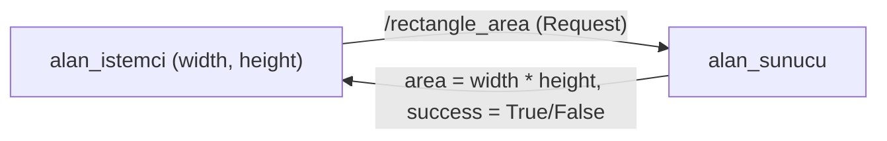
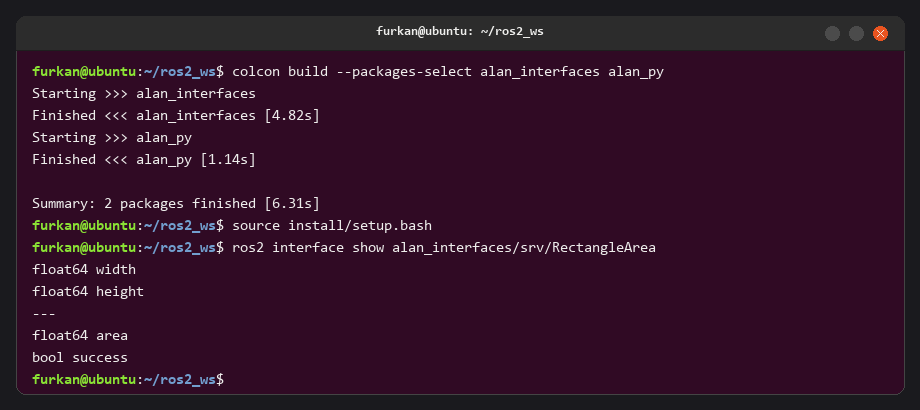
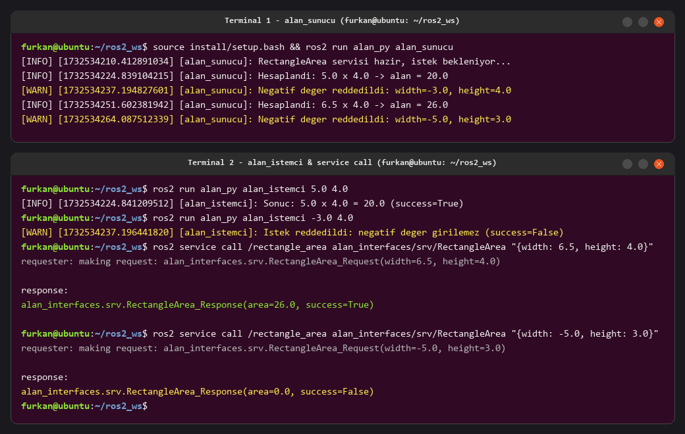

# RectangleArea Servisi (ROS 2 Ödev)

ROS 2 servis ödevi için hazırladığım dikdörtgen alanı hesaplama projesi. `alan_interfaces` paketinde `RectangleArea.srv` arayüzünü tanımladım, `alan_py` paketinde ise bu servisi sunan sunucu ve komut satırından sayı alıp çağıran istemci düğümlerini yazdım.

Bonus kısmı da ekledim: yanıtta `bool success` alanı bulunuyor, genişlik veya yükseklik negatif girilirse sunucu `area: 0.0` ve `success: False` döndürerek isteği reddediyor.

## Servis Akışı



## Klasör Yapısı

```text
servis_odev/
├── alan_interfaces/
│   ├── CMakeLists.txt
│   ├── package.xml
│   └── srv/
│       └── RectangleArea.srv
├── alan_py/
│   ├── alan_py/
│   │   ├── __init__.py
│   │   ├── alan_sunucu.py
│   │   └── alan_istemci.py
│   ├── resource/alan_py
│   ├── package.xml
│   ├── setup.cfg
│   └── setup.py
├── docs/
│   ├── colcon_build.png
│   └── terminal_test.png
└── README.md
```

## Kurulum ve Derleme

İki paketi ROS 2 çalışma alanındaki `src` klasörüne atıp `colcon` ile derliyoruz:

```bash
cp -r alan_interfaces alan_py ~/ros2_ws/src/
cd ~/ros2_ws
colcon build --packages-select alan_interfaces alan_py
source install/setup.bash
```

Arayüzün düzgün oluştuğunu kontrol etmek için:

```bash
ros2 interface show alan_interfaces/srv/RectangleArea
```



## Çalıştırma

### Sunucu

İlk terminalde ortamı kaynaklayıp sunucuyu başlatın:

```bash
source ~/ros2_ws/install/setup.bash
ros2 run alan_py alan_sunucu
```

### İstemci

İkinci terminalde kenar uzunluklarını argüman olarak verip çağırın:

```bash
source ~/ros2_ws/install/setup.bash
ros2 run alan_py alan_istemci 5.0 4.0
```

Negatif değer testi (bonus):

```bash
ros2 run alan_py alan_istemci -3.0 4.0
```

## `ros2 service call` ile Doğrulama

Sunucu ayaktayken doğrudan CLI üzerinden de test ettim:

**Geçerli değerler:**
```bash
$ ros2 service call /rectangle_area alan_interfaces/srv/RectangleArea "{width: 6.5, height: 4.0}"
requester: making request: alan_interfaces.srv.RectangleArea_Request(width=6.5, height=4.0)

response:
alan_interfaces.srv.RectangleArea_Response(area=26.0, success=True)
```

**Negatif değer testi (bonus):**
```bash
$ ros2 service call /rectangle_area alan_interfaces/srv/RectangleArea "{width: -5.0, height: 3.0}"
requester: making request: alan_interfaces.srv.RectangleArea_Request(width=-5.0, height=3.0)

response:
alan_interfaces.srv.RectangleArea_Response(area=0.0, success=False)
```

## Terminal Ekran Görüntüsü



## Kısa Not

Yeni bir terminal açtığınızda `source ~/ros2_ws/install/setup.bash` komutunu çalıştırmayı unutmayın, aksi halde `alan_interfaces` servis tipi bulunamadığı için `ros2 service call` hata verebilir.
